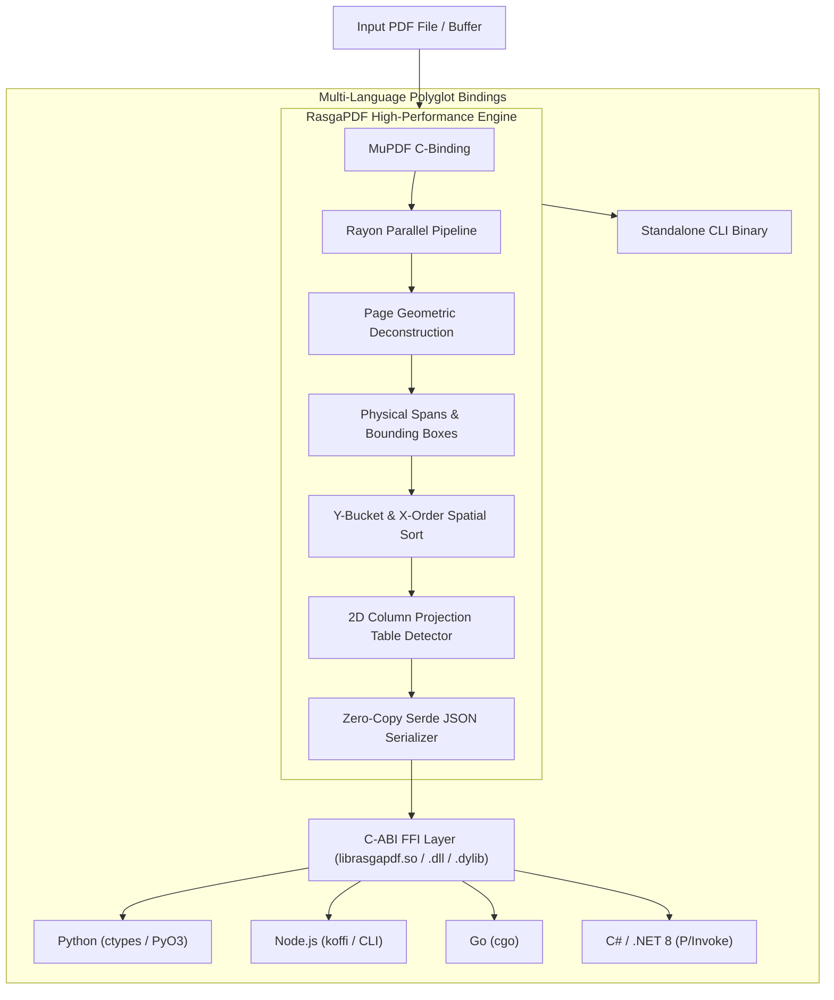

# 🏛️ RasgaPDF Architecture & Technical Design

RasgaPDF was designed with a single uncompromising mission: **deliver 2D physical spatial PDF layout analysis at native hardware speed with sub-millisecond latencies**.

---

## 1. High-Level Architecture Diagram

---

## 2. Core Principles

### A. Zero Guesswork, Exact Geometry
Standard PDF parsers attempt to guess Markdown headers (`# Header`), indentation, or bullet points using fragile heuristics. When applied to multi-column newspapers, medical records, or invoices, these heuristics fail catastrophically.

RasgaPDF returns **exact 2D physical bounds**:
- `x0, y0, x1, y1` (top-left to bottom-right).
- Real typography: Font name, font size, character count.
- Structured table cells with row and column indices.

### B. Embarrassingly Parallel Parsing (`rayon`)
PDF pages are completely independent data structures. RasgaPDF spawns worker threads matching your CPU core count using `rayon::into_par_iter()`. A 100-page document processes simultaneously across all available CPU threads with linear scalability.

### C. Unified C-ABI Polyglot Architecture
Rather than reimplementing geometric algorithms in 5 different languages, RasgaPDF maintains a single source of truth in **Rust (C99 ABI)**. The resulting shared library exports clean, thread-safe functions that can be imported by Python, JavaScript, Go, C#, Java, or C++ with zero friction.
